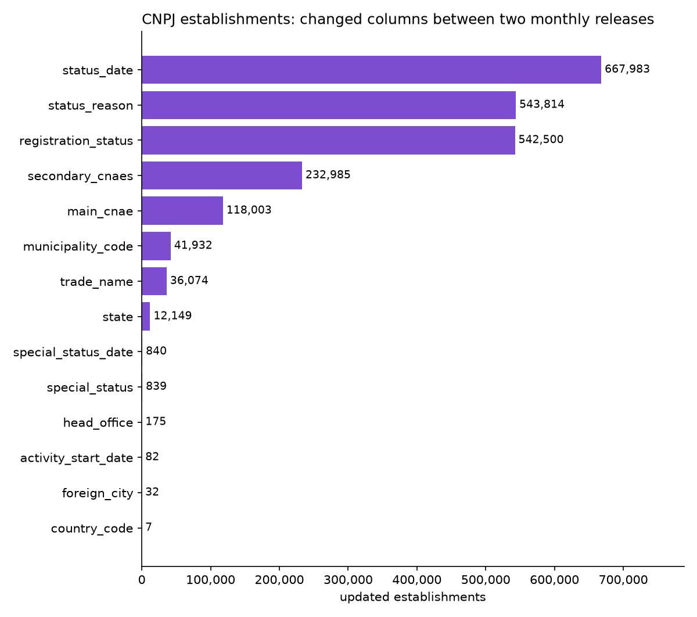

# snapshot-diff

**English** · [Português](README.pt-BR.md)

Compare two snapshots of a table in Parquet by key: which rows were inserted, updated and deleted, and
which columns changed in each updated row. It also keeps a version history (SCD2) that grows only with
the changes, and it shows the table as it was on any day. It uses DuckDB and works with tables that are
larger than memory.

[](https://github.com/ErickBonruque/snapshot-diff/actions/workflows/ci.yml)

[](LICENSE)



## Result

Measured on Brazil's company registry (CNPJ, Receita Federal), establishments table without the
personal columns, October and November 2026 releases. 12-thread machine, DuckDB limited to 3 GB:

| | |
|---|---|
| Rows compared | 73.8 million (Oct) and 74.4 million (Nov); 3-column key |
| Result | 564,038 inserted · 947,151 updated · 0 deleted · 72.9 million unchanged |
| Time / memory | 81 s / 3.2 GB peak |
| Changes file | 33.5 MB of Parquet (each changed row before and after) |
| History | first version: 1.26 GB; November version: 25.7 MB (only the changes) |
| Check | the tables rebuilt from the history are equal to the source releases: 0 differences on 74.4 M rows (Nov) and 73.8 M rows (as of Oct 15) |

The Receita does not delete establishments: when a company closes, its registration status changes to
"closed". This is why 0 rows are deleted. Of the status changes, 219,407 went from active to closed,
154,267 from active to unfit and 108,945 from unfit to active. The tables are in
[`results/`](results/).

On synthetic data (30 million rows, 7 columns, no memory limit) the diff takes 46 s, with a 4.3 GB peak.

## Why

Many data sources publish the full file every month, not the changes. To know what changed, or how
the table was on a given day, you must compare snapshots. SQL `EXCEPT` shows the rows that are
different, but it does not tell an insert from an update, or which column changed. A comparison in
pandas needs both tables in memory, and 70 million rows with 20 columns do not fit.

## How to run

```bash
uv tool install git+https://github.com/ErickBonruque/snapshot-diff
snapshot-diff diff 2026-10/ 2026-11/ --key cnpj_base,cnpj_order,cnpj_check --out changes.parquet
```

Each side can be a file, a glob or a folder of Parquet files. Output of the command above:

```
old rows         73,809,379
new rows         74,373,417
inserted            564,038
updated             947,151
deleted                   0
unchanged        72,862,228
changed columns (updated rows):
  status_date                667,983
  status_reason              543,814
  registration_status        542,500
  ...
time: 80.6 s
```

Version history:

```bash
snapshot-diff history apply hist/ 2026-10/ --key cnpj_base,cnpj_order,cnpj_check --as-of 2026-10-01
snapshot-diff history apply hist/ 2026-11/ --key cnpj_base,cnpj_order,cnpj_check --as-of 2026-11-01
snapshot-diff history export hist/ --as-of 2026-10-15 --out table_on_oct_15.parquet
```

In Python:

```python
from datetime import date

from snapshot_diff import History, diff

result = diff(
    "2026-10/", "2026-11/", key=["cnpj_base", "cnpj_order", "cnpj_check"], output="changes.parquet"
)
print(result.updated, result.changed_columns)

history = History("hist/")
history.apply("2026-11/", key=["cnpj_base", "cnpj_order", "cnpj_check"], as_of=date(2026, 11, 1))
sql = history.as_of_sql(date(2026, 10, 15))  # SQL for DuckDB
```

Options: `--ignore column` (do not compare it), `--json` (summary as JSON), `--memory-limit 4GB`,
`--threads N`.

## How it works

```
old ──► (key, row hash) ──┐
                          ├─ full outer join ─► changed keys ─► full rows ─► compare each column
new ──► (key, row hash) ──┘
```

1. **Phase 1, narrow.** From each snapshot, keep only the key and a hash of the other columns. A full
   outer join of these small tables finds the keys that were inserted, deleted or maybe updated.
2. **Phase 2, only the changes.** For these keys, read the full rows and compare each column with
   `IS DISTINCT FROM` (two NULLs are equal). The large join never carries all the columns of the
   70 million rows.

The key is checked first: a NULL or repeated key is an error, and the message shows examples. Schema
changes are in the summary: added and removed columns are not compared; a column whose type changed is
compared as text. The hash has 64 bits: in theory it can hide an update (about 1 in 10^19 per changed
row); phase 2 never reports an update that did not happen.

Changes file (`--out`): the key columns, `change_type` (`insert`, `update`, `delete`),
`changed_columns` (a list) and `before` / `after` (a struct with the row before and after).

### Append-only history (SCD2)

```
hist/_history.json                         key columns
hist/version=2026-10-01/part-0.parquet     first version: every row
hist/version=2026-11-01/part-0.parquet     later: only inserted, updated and deleted rows
hist/version=2026-11-01/_SUCCESS.json      diff summary
```

- Each stored row has `_op` (`upsert` or `delete`) and `_valid_from`. `_valid_to` and `_is_current`
  are calculated on read with `lead()` (`History.scd2_sql()`), so old files are never rewritten.
- The table on a day uses the last version of each key up to that day: `max()` on narrow columns,
  then a semi join to get the full rows.
- Applying the same date again does nothing; a date before the last one is an error. Each version is
  written to a temporary folder and renamed at the end, so it is complete or absent.
- A new column is compared as if it was NULL before, so it does not cause false updates later.

## Reproduce the demo

The data comes from [brazil-open-data-ingest](https://github.com/ErickBonruque/brazil-open-data-ingest),
which removes addresses, phones, emails and the names of individual entrepreneurs:

```bash
brazil-ingest cnpj ingest 2026-10 --dest data/cnpj --tables establishments
brazil-ingest cnpj ingest 2026-11 --dest data/cnpj --tables establishments
uv run --group demo python scripts/cnpj_demo.py \
  data/cnpj/cnpj/table=establishments/release=2026-10 \
  data/cnpj/cnpj/table=establishments/release=2026-11 --memory-limit 3GB
```

The script writes only aggregates to `results/`; the rows stay in `data/`, which git ignores.

## Stack and decisions

Python 3.11+, DuckDB (joins that spill to disk when memory runs out, native Parquet, SQL), argparse.
Tests with pytest and Hypothesis: a property test makes random tables and checks that applying the diff
to `old` gives exactly `new`. Ruff, strict mypy and CI on Python 3.11 to 3.13 (including the lowest
supported dependency versions).

## Limitations

- Applying a new version to the history is slower than a diff (369 s against 81 s on the CNPJ), because
  it first rebuilds the current table from all versions. There is no compaction of versions.
- If a column type changes between versions, reading the history depends on DuckDB type promotion
  (`union_by_name`).
- Tested on Linux.

## License

MIT
