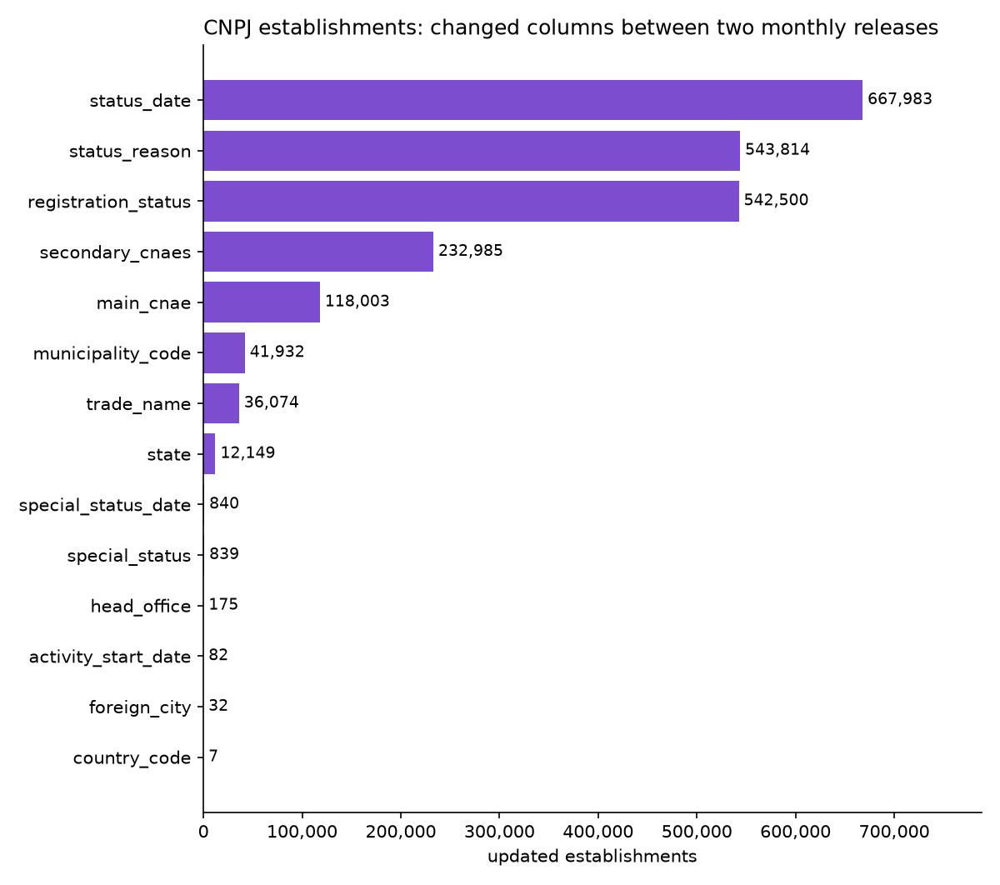

# snapshot-diff

[English](README.md) · **Português**

Compara dois snapshots de uma tabela em Parquet pela chave: quais linhas foram inseridas, alteradas e
removidas, e quais colunas mudaram em cada linha alterada. Também guarda um histórico de versões
(SCD2) que cresce só com o que mudou, e mostra a tabela como estava em qualquer dia. Usa DuckDB e
processa tabelas maiores que a memória.

[](https://github.com/ErickBonruque/snapshot-diff/actions/workflows/ci.yml)

[](LICENSE)



## Resultado

Medido no cadastro de CNPJ da Receita Federal (tabela de estabelecimentos, sem as colunas
pessoais), lançamentos de outubro e novembro de 2026. Máquina de 12 threads, DuckDB limitado a 3 GB:

| | |
|---|---|
| Linhas comparadas | 73,8 milhões (out) e 74,4 milhões (nov); chave de 3 colunas |
| Resultado | 564.038 inseridas · 947.151 alteradas · 0 removidas · 72,9 milhões iguais |
| Tempo / memória | 81 s / 3,2 GB de pico |
| Arquivo de mudanças | 33,5 MB de Parquet (antes e depois de cada linha alterada) |
| Histórico | versão inicial: 1,26 GB; versão de novembro: 25,7 MB (só o que mudou) |
| Conferência | as tabelas reconstruídas do histórico são iguais aos arquivos originais: 0 diferenças em 74,4 milhões de linhas (nov) e em 73,8 milhões (em 15/out) |

A Receita não remove estabelecimentos: quando uma empresa fecha, a situação cadastral muda para
"baixada". Por isso há 0 removidas. Entre as alterações de situação, 219.407 passaram de ativa para
baixada, 154.267 de ativa para inapta e 108.945 de inapta para ativa. As tabelas estão em
[`results/`](results/).

Em dados sintéticos (30 milhões de linhas, 7 colunas, sem limite de memória) o diff leva 46 s, com
pico de 4,3 GB.

## Por que existe

Muitas fontes publicam o arquivo inteiro a cada mês, e não as mudanças. Para saber o que mudou, ou como
a tabela estava num dia, é preciso comparar snapshots. O `EXCEPT` do SQL mostra as linhas diferentes,
mas não diz se foi inserção ou alteração nem qual coluna mudou. Comparar em pandas exige as duas tabelas
na memória, e 70 milhões de linhas com 20 colunas não cabem.

## Como rodar

```bash
uv tool install git+https://github.com/ErickBonruque/snapshot-diff
snapshot-diff diff 2026-10/ 2026-11/ --key cnpj_base,cnpj_order,cnpj_check --out changes.parquet
```

Cada lado pode ser um arquivo, um glob ou uma pasta com Parquet. A saída do comando acima:

```
old rows         73,809,379
new rows         74,373,417
inserted            564,038
updated             947,151
deleted                   0
unchanged        72,862,228
changed columns (updated rows):
  status_date                667,983
  status_reason              543,814
  registration_status        542,500
  ...
time: 80.6 s
```

Histórico de versões:

```bash
snapshot-diff history apply hist/ 2026-10/ --key cnpj_base,cnpj_order,cnpj_check --as-of 2026-10-01
snapshot-diff history apply hist/ 2026-11/ --key cnpj_base,cnpj_order,cnpj_check --as-of 2026-11-01
snapshot-diff history export hist/ --as-of 2026-10-15 --out tabela_em_15_de_outubro.parquet
```

Em Python:

```python
from datetime import date

from snapshot_diff import History, diff

result = diff(
    "2026-10/", "2026-11/", key=["cnpj_base", "cnpj_order", "cnpj_check"], output="changes.parquet"
)
print(result.updated, result.changed_columns)

history = History("hist/")
history.apply("2026-11/", key=["cnpj_base", "cnpj_order", "cnpj_check"], as_of=date(2026, 11, 1))
sql = history.as_of_sql(date(2026, 10, 15))  # SQL para o DuckDB
```

Opções: `--ignore coluna` (não comparar), `--json` (resumo em JSON), `--memory-limit 4GB`, `--threads N`.

## Como funciona

```
old ──► (chave, hash da linha) ──┐
                                 ├─ full outer join ─► chaves que mudaram ─► linhas completas ─► compara coluna a coluna
new ──► (chave, hash da linha) ──┘
```

1. **Fase 1, estreita.** De cada snapshot fica só a chave e um hash das outras colunas. O full outer
   join dessas tabelas pequenas acha as chaves inseridas, removidas e talvez alteradas.
2. **Fase 2, só o que mudou.** Para essas chaves, as linhas completas são lidas e cada coluna é
   comparada com `IS DISTINCT FROM` (dois NULL são iguais). O join pesado nunca carrega todas as colunas
   das 70 milhões de linhas.

A chave é validada antes: chave NULL ou repetida é erro, com exemplos na mensagem. Mudança de esquema
aparece no resumo: coluna nova e coluna removida não entram na comparação; coluna que trocou de tipo é
comparada como texto. O hash tem 64 bits: em tese pode esconder uma alteração (cerca de 1 em 10^19 por
linha alterada); a fase 2 nunca aponta uma alteração que não existe.

Arquivo de mudanças (`--out`): colunas da chave, `change_type` (`insert`, `update`, `delete`),
`changed_columns` (lista) e `before` / `after` (struct com a linha antes e depois).

### Histórico (SCD2) por acréscimo

```
hist/_history.json                         colunas da chave
hist/version=2026-10-01/part-0.parquet     primeira versão: todas as linhas
hist/version=2026-11-01/part-0.parquet     depois: só inseridas, alteradas e removidas
hist/version=2026-11-01/_SUCCESS.json      resumo do diff
```

- Cada linha guardada tem `_op` (`upsert` ou `delete`) e `_valid_from`. `_valid_to` e `_is_current`
  são calculados na leitura com `lead()` (`History.scd2_sql()`); arquivo antigo nunca é reescrito.
- A tabela num dia pega a última versão de cada chave até aquele dia: `max()` em colunas estreitas e
  um semi join com as linhas completas.
- Aplicar a mesma data de novo não faz nada; data anterior à última é erro. Cada versão é gravada numa
  pasta temporária e renomeada no fim, então fica completa ou não existe.
- Coluna nova é comparada como se antes fosse NULL, para não gerar alterações falsas na versão seguinte.

## Reproduzir a demo

Os dados vêm do [brazil-open-data-ingest](https://github.com/ErickBonruque/brazil-open-data-ingest),
que já tira endereço, telefone, e-mail e o nome de empresário individual:

```bash
brazil-ingest cnpj ingest 2026-10 --dest data/cnpj --tables establishments
brazil-ingest cnpj ingest 2026-11 --dest data/cnpj --tables establishments
uv run --group demo python scripts/cnpj_demo.py \
  data/cnpj/cnpj/table=establishments/release=2026-10 \
  data/cnpj/cnpj/table=establishments/release=2026-11 --memory-limit 3GB
```

O script grava só agregados em `results/`; as linhas ficam em `data/`, que o git ignora.

## Stack e decisões

Python 3.11+, DuckDB (joins que usam o disco quando a memória acaba, Parquet nativo, SQL), argparse.
Testes com pytest e Hypothesis: um teste de propriedade gera tabelas aleatórias e confere que aplicar
o diff ao `old` dá exatamente o `new`. Ruff, mypy strict e CI com Python 3.11 a 3.13 (incluindo as
versões mínimas das dependências).

## Limitações

- Aplicar uma versão nova no histórico é mais lento que o diff (369 s contra 81 s no CNPJ), porque
  primeiro reconstrói a tabela atual a partir de todas as versões. Não há compactação de versões.
- Se o tipo de uma coluna muda entre versões, a leitura do histórico depende da promoção de tipos do
  DuckDB (`union_by_name`).
- Testado em Linux.

## Licença

MIT
